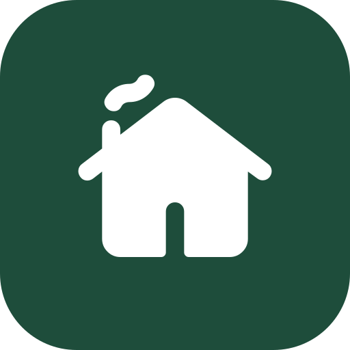

<p align="center">
  
</p>

<h1 align="center">Collabitat API</h1>

<p align="center">Backend for Collabitat, an app for shared households: split costs, rotate chores, plan meals.</p>

<p align="center">
  <a href="https://github.com/fly-die/collabitat-api/actions/workflows/ci.yml"></a>
  <a href="https://sonarcloud.io/summary/new_code?id=fly-die_collabitat-api"></a>
</p>

Frontend: [collabitat-web](https://github.com/fly-die/collabitat-web)

## Run locally

With Docker (API and Postgres):

```sh
docker compose up --build
```

Without Docker (Node 24+), data is kept in memory:

```sh
npm install
npm run dev
```

Set `DATABASE_URL` to use Postgres instead. Migrations run on startup.

The API listens on `http://localhost:3000`. Check it with `curl localhost:3000/health`.

## Deploy

Runs on any Ubuntu 24.04 server: Postgres, the API and [Caddy](https://caddyserver.com) for HTTPS, defined in `deploy/`.

1. Prepare the server once, with the public half of a deploy key:

   ```sh
   ssh root@<host> 'bash -s' -- "$(cat deploy_key.pub)" < deploy/setup-server.sh
   ```

2. In the repository settings under Actions, set:

   | Name | Kind | Value |
   |---|---|---|
   | `DEPLOY_SSH_KEY` | secret | Private half of the deploy key |
   | `DEPLOY_HOST` | variable | Server address |
   | `DEPLOY_KNOWN_HOSTS` | variable | Output of `ssh-keyscan <host>` |
   | `API_DOMAIN` | variable | Domain pointing to the server, e.g. `203-0-113-7.sslip.io` |
   | `WEB_ORIGINS` | variable | Optional, defaults to `https://fly-die.github.io` |

Every push to `main` that passes CI is then deployed. Without `API_DOMAIN` the deploy job is skipped.

## Endpoints

| Method | Path | Purpose |
|---|---|---|
| `GET` | `/health` | Health check |
| `POST` | `/households` | Create a household and an account (`{ "name": "...", "memberName": "...", "email": "...", "password": "..." }`) |
| `GET` | `/invites/:inviteCode` | Household name and flatmates who have not joined yet |
| `POST` | `/invites/:inviteCode/members` | Join under a new name with an account (`{ "name": "...", "email": "...", "password": "..." }`) |
| `POST` | `/invites/:inviteCode/members/:memberId/join` | Join as a flatmate someone already added (`{ "email": "...", "password": "..." }`) |
| `POST` | `/sessions` | Log in (`{ "email": "...", "password": "..." }`), 5 tries per email per minute |
| `DELETE` | `/session` | Log out |
| `POST` | `/household/account` | Add an account for a flatmate who joined before accounts existed |
| `GET` | `/household` | Your household with its members |
| `POST` | `/household/members` | Add a flatmate (`{ "name": "..." }`) |
| `PUT` | `/household/me` | Change my own name: `{"name": "Mia"}` |
| `DELETE` | `/household/members/:memberId` | Remove a flatmate who is not part of any expense |
| `GET` | `/household/expenses` | Expenses, payments, balances and the suggested payments to settle up |
| `POST` | `/household/expenses` | Add an expense, split equally (see below) |
| `PUT` | `/household/expenses/:expenseId` | Fix an expense, with the same body as adding one |
| `DELETE` | `/household/expenses/:expenseId` | Delete an expense |
| `POST` | `/household/settlements` | Record a payment (`{ "fromMemberId": "...", "toMemberId": "...", "amountCents": 1500, "settledOn": "2026-10-31" }`) |
| `DELETE` | `/household/settlements/:settlementId` | Delete a payment |
| `GET` | `/household/tasks` | Recurring chores, soonest due first |
| `POST` | `/household/tasks` | Add one: `title`, `every`, `unit` (`day`, `week`, `month`), `firstDueOn`, optional `rotationMemberIds` (who takes turns, default everyone) |
| `PUT` | `/household/tasks/:taskId` | Change a chore (same body); what was done and whose turn it is stay |
| `DELETE` | `/household/tasks/:taskId` | Delete a chore |
| `POST` | `/household/tasks/:taskId/completions` | Mark it done on `doneOn`; next due is one interval later |
| `DELETE` | `/household/tasks/:taskId/completions/:completionId` | Undo marking it done |
| `GET` (WebSocket) | `/household/live` | Send `{"token": "<session token>"}` first; then get `{"type": "changed", "topic": "money" \| "chores" \| "household" \| "meals" \| "calendar" \| "notes"}` whenever someone in the household changes something |
| `GET` | `/push/public-key` | The key browsers subscribe with; 404 when notifications are off |
| `PUT` | `/household/push-subscription` | Turn notifications on for this device (a browser push subscription) |
| `DELETE` | `/household/push-subscription` | Turn them off again: `{"endpoint": "..."}` |
| `GET` | `/household/meals?from=YYYY-MM-DD` | Seven days of dinners from that day, and the saved recipes |
| `PUT` | `/household/meals/:date?from=...` | Plan a day's dinner: `title` and/or `recipeId`, optional `cookMemberId` |
| `DELETE` | `/household/meals/:date?from=...` | Clear a day |
| `POST` | `/household/recipes?from=...` | Save a recipe: `title`, `servings`, `ingredientLines` like `500 g pasta` |
| `PUT` | `/household/recipes/:recipeId?from=...` | Change a recipe (same body); dinners planned with it take its new name |
| `DELETE` | `/household/recipes/:recipeId?from=...` | Delete a recipe; planned dinners keep their name |
| `GET` | `/household/shopping-list?from=YYYY-MM-DD` | What the week's dinners need, added up across recipes and units, grouped by shop category; each item has a `key` and `checked`, plus who is shopping (`trip`) |
| `POST` | `/household/shopping-list/items?from=...` | Add an item by hand: `{"line": "2 l milk"}` |
| `DELETE` | `/household/shopping-list/items/:itemId?from=...` | Remove an item added by hand |
| `POST` | `/household/shopping-list/recipes/:recipeId?from=...` | Put a recipe's ingredients on the list as items added by hand; answers with the list and the `addedItemIds` |
| `PUT` | `/household/shopping-list/checks?from=...` | Tick an item off or back on: `{"key": "...", "checked": true}` |
| `GET` | `/household/shopping-trip` | The list someone is shopping right now, or `{"trip": null}` |
| `POST` | `/household/shopping-trip?from=...` | Start shopping that week's list; a trip already going is kept |
| `DELETE` | `/household/shopping-trip?from=...` | Stop shopping without paying |
| `POST` | `/household/shopping-trip/checkout?from=...` | Pay: takes an expense (see below), ends the trip and removes ticked items added by hand; answers with the list and the `expenseId` |
| `GET` | `/household/calendar?from=YYYY-MM-DD` | Four weeks of important dates from that day, with the calendar's columns (people or groups) |
| `POST` | `/household/calendar/columns` | Add a column: `{"name": "Noah"}` |
| `DELETE` | `/household/calendar/columns/:id` | Remove a column without upcoming dates; its past dates move to everyone |
| `POST` | `/household/calendar/entries` | Add a date: `{"title": "Dentist", "day": "2026-11-05", "time": "14:30", "columnId": "..."}`; `time` and `columnId` are optional |
| `PUT` | `/household/calendar/entries/:id` | Change a date (same body) |
| `DELETE` | `/household/calendar/entries/:id` | Remove a date |
| `GET` | `/household/notes` | The household's quick notes: open ones newest first, then done ones |
| `POST` | `/household/notes` | Add a note: `{"text": "Bins out on Monday"}`; `"done": true` puts back a cleared note |
| `PUT` | `/household/notes/:id/done` | Tick a note off or back on: `{"done": true}` |
| `DELETE` | `/household/notes/:id` | Remove a note |
| `DELETE` | `/household/notes/done` | Clear all done notes; answers with what was removed |

Creating, joining or logging in returns a `token`. Send it as `Authorization: Bearer <token>` to the `/household` endpoints.

An expense looks like `{ "description": "Groceries", "amountCents": 4550, "paidByMemberId": "...", "splitBetweenMemberIds": ["..."], "spentOn": "2026-10-30" }`. Amounts are whole cents. Leftover cents of an uneven split go to the first members, so shares always add up. A positive balance means the household owes that member. Suggested payments (`transfers`) settle everyone in at most one payment less than the number of people.

## Scripts

| Command | Purpose |
|---|---|
| `npm run dev` | Start with reload |
| `npm test` | Run tests |
| `npm run test:coverage` | Run tests with coverage |
| `npm run lint` | Lint |
| `npm run build` | Compile to `dist` |

## Stack

Fastify, TypeScript, PostgreSQL, Drizzle, Vitest.

## License

[MIT](LICENSE). Logo uses the "cottage" icon from [Material Symbols](https://github.com/google/material-design-icons) (Apache 2.0).

## Notifications

Set `VAPID_PUBLIC_KEY` and `VAPID_PRIVATE_KEY` (create them with `npx web-push generate-vapid-keys`) to send notifications: a morning reminder when a chore is your turn, and a note when a flatmate adds an expense you share. Without them, notifications are off.
